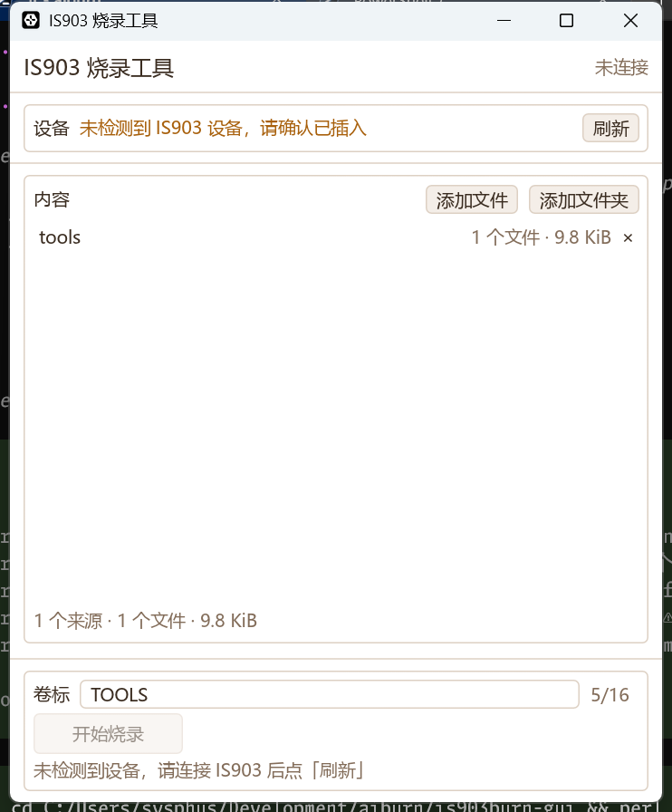

# is903burn — native Linux replacement for AIBurn.exe

`AIBurn.exe` is a 32-bit Windows Delphi GUI that burns ISO images onto an
Innostar IS903 "USB Flash CD-ROM" (UFCD) chip using vendor SCSI commands.
`is903burn` is a native Linux reimplementation of that protocol, speaking
`SG_IO` directly to `/dev/sg0`.

## 桌面程序（Linux、macOS 和 Windows）

`is903burn-gui` 在三个平台使用相同的 GUI、CLI 和 ISO 生成器，支持 ISO 9660 + Joliet 和中文文件名。以下命令从仓库根目录运行。构建需要 Rust 1.95 或更新版本。

| 平台 | 构建命令 | 构建依赖 |
| --- | --- | --- |
| Linux | `./is903burn-gui/build-linux.sh` | C 工具链和 pkg-config。例如 Debian/Ubuntu 的 `build-essential`、`pkg-config` |
| macOS | `./is903burn-gui/build-macos.sh` | Xcode Command Line Tools、libusb 1.0.30 或更新版本（`brew install libusb`） |
| Windows | `powershell -ExecutionPolicy Bypass -File .\is903burn-gui\build-windows.ps1` | Rust 1.95+ 与 MSVC 工具链（`rustup default stable-x86_64-pc-windows-msvc`），无额外依赖 |

这些脚本在各自的系统上构建 Release 版，默认输出到 `is903burn-gui/target/release/`。macOS 构建使用 Homebrew 的 libusb，也可通过 `IS903_LIBUSB_PREFIX` 指定安装路径。运行时需要保留对应的 libusb 动态库。

```sh
./is903burn-gui/target/release/is903burn-gui            # 启动 GUI
./is903burn-gui/target/release/is903burn-gui --devices  # 列出设备
```

- **Linux**：光驱烧录使用 `SG_IO`。需要加载 `sg` 模块并具备目标 `/dev/sgN` 的读写权限。挂载与卸载依赖 `udisksctl`（`udisks2`），刷新光驱时系统可能通过 `pkexec` 请求授权。
- **macOS**：光驱烧录使用 libusb 接管 USB 接口。通过终端以管理员权限执行 `--burn`。挂载与卸载使用系统自带的 `diskutil`。[macOS 用法与实测记录](macOS.md)
- **Windows**：光驱烧录使用 `DeviceIoControl(IOCTL_SCSI_PASS_THROUGH_DIRECT)` 直通到卷句柄 `\\.\X:`，**不需要管理员权限**。烧录后用 `FSCTL_LOCK_VOLUME` + `FSCTL_DISMOUNT_VOLUME` 刷新光驱视图，不需要 restart 设备。挂载由系统自动完成。只有「大容量存储模式」的原始块写入需要管理员权限。[Windows 实现与实测记录](windows.md)

### 图形界面

界面固定浅色配色（白底 + 棕色强调，不跟随系统深色）：顶部是设备，中间是烧录内容，底部是卷标和主按钮。



- 把文件或文件夹直接拖进窗口即可加入列表；文件夹里的内容会放到光盘根目录。
- 点击空列表也可以选择文件；每个来源显示大小（文件夹显示文件数），`✕` 移除。
- 快捷键：`Enter` 打开确认框，`F5` 重新扫描设备。烧录中可按「取消」中止，但写入已开始时
  光盘内容可能不完整。
- 卷标默认取第一个来源的名字（最多 16 个字符），手动改过后不再自动更新。
- 设备未就绪（例如光驱里没有光盘）时按钮为灰色，并在设备区域里说明原因。
- 也可以把文件/文件夹拖到 `is903burn-gui.exe` 图标上，界面会带着这些来源启动。
- Windows 便携版就是一个 `is903burn-gui.exe`（约 4.7 MB）：静态链接 MSVC 运行库，
  不需要安装 VC++ 运行库、也不依赖其它 DLL，可以拷到 U 盘直接用。
  `build-windows.ps1 -Portable` 会连同使用说明打成 zip。

**文件名长度**：ISO 里同时写 ISO 9660 主树（8.3 短名，仅作老设备的兼容回退）和 Joliet 树
（原名、中文）。Joliet 单个名字最长 **64 个字符**，这是 Windows、Linux、macOS 通行的上限，
也是 `genisoimage` 的默认值；超过的文件名会被截断，界面在烧录完成时提示并在「运行详情」
里列出具体文件名。目录层级最多 8 层（ISO 9660 限制），超过会直接报错而不是写出坏镜像。

下面的 CLI 用法适用于三个平台。macOS 光驱烧录时在烧录命令前加 `sudo`。目标设备以 `--devices` 的输出为准：Linux 是 `/dev/sr0` 一类设备节点，Windows 是驱动器号 `D:`。

```sh
./is903burn-gui/target/release/is903burn-gui --mkiso ./data -l MYDATA -o /tmp/data.iso
./is903burn-gui/target/release/is903burn-gui --burn 设备 -l MYDATA ./data
```

### 现成 ISO 的读写与校验

```sh
is903burn-gui --dump   <设备> current.iso   # 导出设备里现有的镜像
is903burn-gui --verify <设备> current.iso   # 只读校验，不改动设备
is903burn-gui --write  <设备> new.iso       # 把现成 ISO 写进设备（破坏性）
```

`--dump` 与 `--verify` 只读，可用于备份与事后核对；`--write` 与 `--burn`
会覆盖光盘内容。

**Documentation**

* [使用流程.md](使用流程.md) — 完整操作手册(中文):环境准备、设备确认、
  提取镜像、制作 ISO、烧录、校验、故障排查、一键脚本。
* [windows.md](windows.md) — Windows 后端实现与真机实测记录。
* `is903-burn.sh` — 一键烧录脚本(推荐日常使用)。
* [PROTOCOL.md](PROTOCOL.md) — the reverse engineered vendor SCSI protocol.
* [README.md](README.md) — this file: build and command reference.

## Build the Linux C utility

```sh
make
```

Requirements: a C compiler and the `scsi/sg.h` header (glibc).

## Setup

The Linux kernel needs the `sg` module for `/dev/sg0` to appear:

```sh
sudo modprobe sg
```

On Arch/Omarchy the module is not loaded by default. If `/dev/sg*` is
missing, load it first.

You also need read/write access to `/dev/sg0`. Depending on the mode the
device comes up in, it may be owned by `root:optical` or `root:disk`:

```sh
sudo setfacl -m u:$USER:rw /dev/sg0
```

## Quick start: the wrapper script

For everyday use there is `is903-burn.sh`, which wraps the whole flow
(build ISO → unmount → capacity check → burn → cache flush → verify →
mount → per-file hash check):

```sh
./is903-burn.sh ~/Downloads/Aahj.ttf        # burn a file
./is903-burn.sh ~/Documents -l MYDATA       # burn a folder
./is903-burn.sh ./data --dry-run            # show what would happen
```

See [使用流程.md](使用流程.md#附-a一键脚本-is903-burnsh) for all options.

## Usage

```
is903burn list                        # find the IS903
is903burn info                        # identification / capability list
is903burn capacity                    # standard SCSI READ CAPACITY of the disc
is903burn status                      # P.M. status/info sub commands
is903burn dump  <out.iso>             # extract the ISO image   (VERIFIED)
is903burn burn  <in.iso>               # burn an ISO image       (VERIFIED, destructive)
is903burn read  <lba> <blocks> <out>  # raw P.M. read (vendor protocol)
is903burn write <lba> <in.iso>         # raw P.M. write (vendor protocol)
is903burn key   [--pcs n]             # 12 byte challenge/response exchange
is903burn raw   <hex-cdb> [dir] [len] # send an arbitrary vendor CDB
```

`dump` and `burn` are the ones to use: they operate on the block device and
have been verified end to end on real hardware. `read`/`write` use the
vendor `P.M.` commands decoded from AIBurn.exe, which the device refuses in
both of its modes.

The device can be selected with `--dev /dev/sg0` or `--dev <index>`; by
default the first IS903 found is used.

### Examples

```sh
$ is903burn list
NODE       VENDOR       PRODUCT    TYPE NOTE
/dev/sg0   Innostar    CD-ROM on Flash   5   <- IS903
           /dev/sr0

$ is903burn info
INQU reply (134 bytes):
  ...
supported command groups:
  0  INQU
  1  PINF
  2  EXEC
  3  NAND
  4  TEPF
  5  NFTL
  6  P.M.
```

Extract the image currently on the device:

```sh
$ is903burn dump current.iso
ISO volume: 1376 sectors of 2048 bytes (2818048 bytes)
wrote current.iso
```

Burn a new image (destructive — this overwrites the disc content):

```sh
$ is903burn burn new.iso --force
wrote 2818048 bytes (1376 ISO sectors) to /dev/sda
```

Unmount the device first, and remount it afterwards for the new content to
show up:

```sh
udisksctl unmount -b /dev/sda
is903burn burn new.iso --force
udisksctl mount   -b /dev/sda
```

`burn` refuses to run without `--force`.

### Burning a folder or file

`is903burn` burns ISO images. To put arbitrary files on the device, build an
ISO first with `xorrisofs` (package `xorriso`):

```sh
xorrisofs -o data.iso -V MYDISC -J -R /path/to/folder

udisksctl unmount -b /dev/sda
is903burn burn data.iso --force
udisksctl mount -b /dev/sda      # now mounted as /run/media/$USER/MYDISC
```

`-J` adds a Joliet tree (long file names, UTF-8) and `-R` adds Rock Ridge
(POSIX permissions, symlinks). Use `-J` alone if the disc should be readable
on Windows as well.

A smaller ISO may be burned over a larger one; the extra old data is simply
ignored because the ISO 9660 volume descriptor declares the volume size.

## Tests

```sh
./tests/run-tests.sh
```

The test suite runs against a mock IS903 device (`tests/mock_is903.c`, a
`LD_PRELOAD` shim that emulates `SG_IO`), so it needs no hardware.

`./test-is903.sh` is the equivalent smoke test against real hardware.

## Notes and caveats

* `dump` and `burn` have been verified end to end on real hardware. They
  work on the block device, which requires the chip to come up in
  mass-storage mode.
* The `read`/`write` subcommands use the vendor `P.M.` commands decoded
  from AIBurn.exe. The device refuses those opcodes in both of its modes,
  so they are kept only for protocol exploration.
* The chip enumerates in one of two modes depending on how it is powered
  up: as a CD-ROM (SCSI type 5, `/dev/sr0` plus `/dev/sg0`, read only) or
  as USB mass storage (SCSI type 0, `/dev/sda` plus `/dev/sg0`,
  writable). Only the mass-storage mode can be burned.
* `burn` is **destructive** and overwrites the image from offset 0. The
  device is left with whatever the ISO contains.
* The device firmware can wedge if it receives malformed vendor commands.
  A wedged device does not re-enumerate over USB; it needs a physical
  unplug/replug.
* `raw` and `probe` are provided for protocol exploration. Be careful with
  them — sending a bogus command can hang the device firmware. `probe`
  therefore requires `--force` as well.
* The command group index in CDB byte 1 must match the ASCII tag in bytes
  12-15. The tool discovers the real group list from the device with
  `INQU` at startup, so it works even if the device implements a different
  set of groups than the default table.
